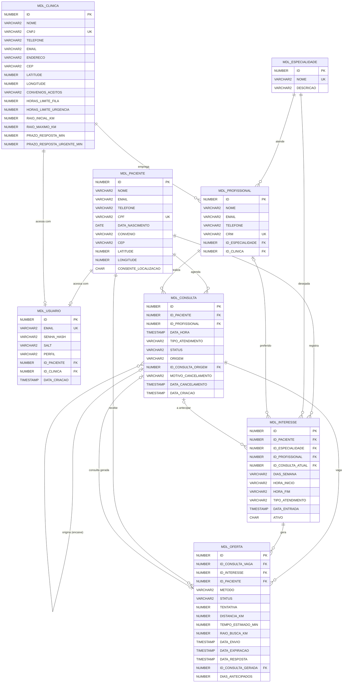
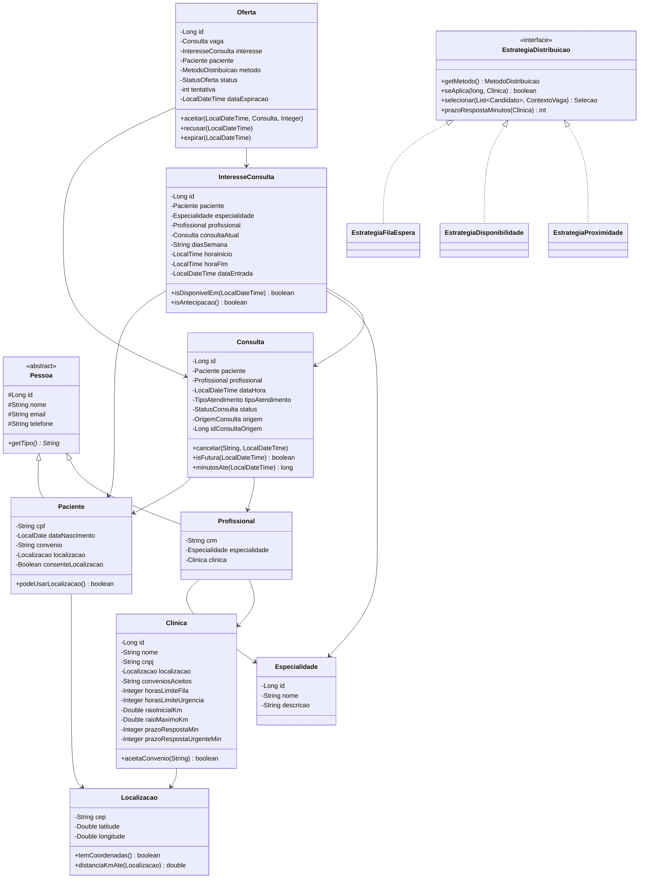

# Medlink API

**Plataforma inteligente de aproveitamento de consultas canceladas** — Global Solution 2026.2 (CitizenTech) · Domain Driven Design – Java

O Medlink conecta pacientes que querem antecipar (ou conseguir) uma consulta com clínicas que ficaram com horários vagos por cancelamento. Quando uma consulta é cancelada, a API escolhe automaticamente **como** distribuir a vaga, de acordo com o tempo que falta até o atendimento:

| Tempo até a consulta (configurável por clínica) | Método | Critério | Prazo para responder |
|---|---|---|---|
| Mais de 24h | `FILA_ESPERA` | Ordem de entrada na lista de interesse | 120 min |
| Entre 6h e 24h | `DISPONIBILIDADE` | Disponibilidade declarada + ordem da lista | 30 min |
| Menos de 6h | `PROXIMIDADE` | Menor tempo estimado de deslocamento até a clínica; o raio de busca dobra (5 → 10 → 20 → 30 km) se ninguém estiver perto | 15 min |

Regras garantidas pelo sistema:

- Compatibilidade: especialidade, profissional de preferência, convênio aceito pela clínica, tipo de atendimento (presencial/teleconsulta), dias e horários disponíveis.
- Se o paciente quer **antecipar** uma consulta, a vaga só é oferecida se for realmente antes dela. Quando ele aceita, a consulta antiga é cancelada e **vira uma nova vaga, distribuída na hora** (efeito cascata).
- Cada vaga tem **apenas uma oferta ativa por vez** (regra no BO e índice único no Oracle).
- Recusa ou falta de resposta no prazo → a vaga passa automaticamente para o próximo (verificação de expiração a cada minuto).
- Localização só é usada com consentimento do paciente (LGPD) e pode ser a do CEP/bairro, sem rastreamento em tempo real.

---

## Tecnologias

| Ferramenta | Versão |
|---|---|
| Java (JDK) | 21 |
| Spring Boot | 3.4.5 (Web, JDBC, Validation) |
| Maven | 3.9+ |
| Banco de dados | Oracle (servidor da FIAP) · driver `ojdbc11` |
| Documentação dos endpoints | springdoc-openapi (Swagger UI) |
| Deploy | Render (Docker) |
| IDE sugerida | IntelliJ IDEA |

## Arquitetura

```
src/main/java/br/com/fiap/medlink
├── model/               Camada modelo (entidades do domínio)
│   ├── enums/           StatusConsulta, StatusOferta, MetodoDistribuicao, TipoAtendimento...
│   ├── Pessoa (abstrata) ← Paciente, Profissional
│   ├── Localizacao      Objeto de valor (CEP + coordenadas, cálculo de distância)
│   └── Clinica, Especialidade, Consulta, InteresseConsulta, Oferta
├── dao/                 Acesso ao banco com JDBC (PreparedStatement), uma classe por tabela
├── bo/                  Regras de negócio (validações, cancelamento, aceite, indicadores)
│   └── distribuicao/    Algoritmo de distribuição (padrão Strategy)
│       ├── EstrategiaDistribuicao (interface)
│       ├── EstrategiaFilaEspera / EstrategiaDisponibilidade / EstrategiaProximidade
│       └── AnalisadorCompatibilidade
├── controller/          Endpoints REST (GET, POST, PUT, PATCH, DELETE)
├── exception/           Exceções do domínio + GlobalExceptionHandler (@RestControllerAdvice)
├── dto/                 Objetos de entrada/saída específicos (simulação, indicadores...)
└── config/              Relógio (fuso de Brasília), CORS e Swagger
```

Fluxo de uma requisição: `Controller → BO → DAO → Oracle`. Os DAOs obtêm a conexão pelo `DataSource` do Spring, então várias operações de um BO marcado com `@Transactional` são confirmadas ou desfeitas juntas (ex.: aceitar uma oferta cria a consulta, encerra a oferta e libera a consulta antiga numa única transação).

---

## Como executar

### 1. Criar as tabelas no Oracle da FIAP

No SQL Developer, conectado com seu RM, execute na ordem:

1. `sql/01_create_tables.sql` — cria as 7 tabelas (prefixo `MDL_`), constraints e índices
2. `sql/02_seed.sql` — dados de demonstração (clínica fictícia, 3 profissionais, 7 pacientes, lista de interesse)
3. `sql/03_demo_vagas.sql` — *(opcional)* mais pacientes e consultas para demonstrar os três métodos. Rode perto da apresentação, porque as datas são calculadas a partir da hora da execução
4. `sql/04_login.sql` — tabela de contas de acesso (`MDL_USUARIO`) e logins de demonstração, todos com a senha `123456`:
   - clínica: `contato@vidapaulista.com.br`
   - pacientes: `ana@email.com`, `bruno@email.com`, `elaine@email.com` etc.

Para recomeçar do zero: `sql/99_drop_tables.sql` e depois os scripts de novo, na ordem.

### 2. Configurar as credenciais

A aplicação lê o banco de variáveis de ambiente (a senha **não** fica no código, porque o repositório é público):

| Variável | Exemplo |
|---|---|
| `DB_URL` | `jdbc:oracle:thin:@oracle.fiap.com.br:1521:ORCL` (padrão) |
| `DB_USER` | `rm123456` |
| `DB_PASSWORD` | sua senha |

**IntelliJ:** Run → Edit Configurations → `MedlinkApplication` → *Environment variables* → `DB_USER=rm123456;DB_PASSWORD=suasenha`

### 3. Rodar

```bash
mvn spring-boot:run
```

Ou execute a classe `MedlinkApplication` pelo IntelliJ. A API sobe em `http://localhost:8080`.

- Swagger UI: `http://localhost:8080/swagger-ui.html`
- Teste rápido: `GET http://localhost:8080/especialidades`

### Opcional: rodar sem Oracle (H2 em memória)

Para testar em casa sem acesso ao Oracle, o perfil `h2` cria as mesmas tabelas e dados num banco em memória (em modo de compatibilidade Oracle):

```bash
mvn spring-boot:run -Dspring-boot.run.profiles=h2
```

Os dados somem quando a aplicação para. A entrega oficial usa o Oracle.

### Testes unitários

```bash
mvn test
```

Testam as três estratégias de distribuição (escolha do método, ordem da fila, prioridade por proximidade, ampliação do raio e descarte de quem não chega a tempo).

---

## Deploy no Render

1. Suba o projeto para o GitHub.
2. No [Render](https://render.com): **New → Web Service** → conecte o repositório.
3. *Runtime*: **Docker** (o `Dockerfile` da raiz já compila e empacota o projeto). *Plan*: Free.
4. Em **Environment**, adicione `DB_USER` e `DB_PASSWORD` (e `DB_URL`, se for diferente do padrão).
5. **Create Web Service**. O link fica no formato `https://medlink-api.onrender.com`.

Alternativa: **New → Blueprint** usando o `render.yaml` da raiz.

> No plano gratuito o serviço "dorme" após 15 min sem acesso; a primeira requisição depois disso pode levar cerca de 1 minuto.

---

## Endpoints

Base local: `http://localhost:8080`

| Recurso | Método | Endpoint | Descrição |
|---|---|---|---|
| Contas | POST | `/auth/login` | Entra com e-mail e senha; responde se a conta é `PACIENTE` ou `CLINICA` |
| | POST | `/auth/cadastro/paciente` | Cria a conta e o cadastro do paciente |
| | POST | `/auth/cadastro/clinica` | Cria a conta e o cadastro da clínica |
| Especialidades | GET | `/especialidades` | Lista todas |
| | GET | `/especialidades/{id}` | Busca por ID |
| | POST | `/especialidades` | Cadastra |
| | PUT | `/especialidades/{id}` | Atualiza |
| | DELETE | `/especialidades/{id}` | Remove |
| Clínicas | GET | `/clinicas` | Lista todas |
| | GET | `/clinicas/{id}` | Busca por ID |
| | GET | `/clinicas/{id}/indicadores` | Painel de resultados da clínica |
| | POST | `/clinicas` | Cadastra (com parâmetros de distribuição) |
| | PUT | `/clinicas/{id}` | Atualiza |
| | DELETE | `/clinicas/{id}` | Remove |
| Profissionais | GET | `/profissionais?clinica=&especialidade=` | Lista (filtros opcionais) |
| | GET | `/profissionais/{id}` | Busca por ID |
| | POST | `/profissionais` | Cadastra |
| | PUT | `/profissionais/{id}` | Atualiza |
| | DELETE | `/profissionais/{id}` | Remove |
| Pacientes | GET | `/pacientes` | Lista todos |
| | GET | `/pacientes/{id}` | Busca por ID |
| | POST | `/pacientes` | Cadastra |
| | PUT | `/pacientes/{id}` | Atualiza |
| | DELETE | `/pacientes/{id}` | Remove |
| Consultas | GET | `/consultas?status=&paciente=&profissional=&clinica=` | Lista a agenda (filtros opcionais) |
| | GET | `/consultas/{id}` | Busca por ID |
| | POST | `/consultas` | Agenda uma consulta |
| | PUT | `/consultas/{id}` | Reagenda uma consulta AGENDADA |
| | DELETE | `/consultas/{id}` | Remove |
| | POST | `/consultas/{id}/cancelar` | **Cancela e dispara a distribuição da vaga** |
| | GET | `/consultas/{id}/simulacao` | Mostra método, ranking e excluídos sem enviar oferta |
| | POST | `/consultas/{id}/redistribuir` | Tenta de novo distribuir uma vaga aberta |
| | PATCH | `/consultas/{id}/realizada` | Marca a consulta como realizada |
| Lista de interesse | GET | `/interesses?paciente=&especialidade=&ativo=` | Lista (filtros opcionais) |
| | GET | `/interesses/{id}` | Busca por ID |
| | POST | `/interesses` | Paciente entra na lista |
| | PUT | `/interesses/{id}` | Atualiza preferências (mantém a posição na fila) |
| | DELETE | `/interesses/{id}` | Sai da lista |
| Ofertas | GET | `/ofertas?vaga=&paciente=&status=&clinica=` | Lista (filtros opcionais) |
| | GET | `/ofertas/{id}` | Busca por ID |
| | POST | `/ofertas/{id}/aceitar` | Paciente aceita a vaga |
| | POST | `/ofertas/{id}/recusar` | Paciente recusa; vaga vai para o próximo |

### Exemplos de corpo (JSON)

**POST /auth/login**
```json
{ "email": "ana@email.com", "senha": "123456" }
```
Resposta:
```json
{ "idUsuario": 1, "email": "ana@email.com", "perfil": "PACIENTE", "nome": "Ana Souza", "idPaciente": 1 }
```

**POST /auth/cadastro/paciente** (o objeto `paciente` tem os mesmos campos do `POST /pacientes`; no cadastro de clínica, use `clinica` com os campos do `POST /clinicas`)
```json
{
  "email": "helena@email.com",
  "senha": "minhasenha",
  "paciente": { "nome": "Helena Martins", "cpf": "88888888888", "convenio": "UNIMED", "consenteLocalizacao": false }
}
```

As senhas são guardadas apenas como hash PBKDF2 com salt aleatório por usuário (recurso nativo do Java). No MVP, o login identifica o perfil e o front mostra as funções de cada um; os demais endpoints não exigem token.

**POST /pacientes**
```json
{
  "nome": "Helena Martins",
  "email": "helena@email.com",
  "telefone": "11987654321",
  "cpf": "88888888888",
  "dataNascimento": "1995-04-10",
  "convenio": "UNIMED",
  "localizacao": { "cep": "01311-000", "latitude": -23.5614, "longitude": -46.6559 },
  "consenteLocalizacao": true
}
```

**POST /consultas**
```json
{
  "paciente": { "id": 7 },
  "profissional": { "id": 1 },
  "dataHora": "2026-12-01T14:00:00",
  "tipoAtendimento": "PRESENCIAL"
}
```

**POST /interesses**
```json
{
  "paciente": { "id": 8 },
  "especialidade": { "id": 1 },
  "profissional": { "id": 1 },
  "consultaAtual": { "id": 5 },
  "diasSemana": "SEG,QUA,SEX",
  "horaInicio": "08:00",
  "horaFim": "18:00",
  "tipoAtendimento": "QUALQUER"
}
```
`profissional` e `consultaAtual` são opcionais (preferência de profissional e consulta que o paciente quer antecipar).

**POST /clinicas**
```json
{
  "nome": "Clínica Exemplo",
  "cnpj": "98765432000110",
  "endereco": "Rua Exemplo, 100",
  "localizacao": { "cep": "01310-000", "latitude": -23.5630, "longitude": -46.6540 },
  "conveniosAceitos": "UNIMED,AMIL,PARTICULAR",
  "horasLimiteFila": 24,
  "horasLimiteUrgencia": 6,
  "raioInicialKm": 5,
  "raioMaximoKm": 30,
  "prazoRespostaMin": 120,
  "prazoRespostaUrgenteMin": 15
}
```
Os parâmetros de distribuição são opcionais; se omitidos, valem os padrões acima.

**POST /consultas/{id}/cancelar** (corpo opcional)
```json
{ "motivo": "Paciente com imprevisto no trabalho" }
```

### Erros

Todas as falhas retornam o mesmo formato:

```json
{
  "timestamp": "2026-11-16T10:30:00",
  "status": 400,
  "erro": "Bad Request",
  "mensagem": "Dados inválidos na requisição",
  "caminho": "/pacientes",
  "campos": [ { "campo": "cpf", "mensagem": "O CPF deve conter 11 dígitos numéricos" } ]
}
```

| Status | Quando |
|---|---|
| 400 | JSON inválido ou campos que não passam na validação |
| 401 | E-mail ou senha incorretos no login |
| 404 | Registro ou rota inexistente |
| 409 | Duplicidade (CPF, CNPJ, CRM), horário ocupado, registro em uso |
| 422 | Regra de negócio violada (ex.: cancelar consulta que já passou, aceitar oferta expirada) |
| 500 | Erro inesperado ou de banco |

---

## Roteiro de demonstração (dados do `02_seed.sql`)

IDs considerando as tabelas recém-criadas: Cardiologia = 1, Clínica Vida Paulista = 1, Dr. Ricardo = 1, pacientes Ana = 1 · Bruno = 2 · Carla = 3 · Diego = 4 · Elaine = 5 · Fábio = 6 · Gabriela = 7. Consulta 1 = Gabriela daqui a 10 dias; consulta 2 = Bruno daqui a 40 dias (ele quer antecipar).

1. `GET /consultas/1/simulacao` — método `FILA_ESPERA`; ranking Elaine → Diego → Bruno → Ana. Fábio aparece nos excluídos (convênio HAPVIDA não aceito), mesmo tendo entrado primeiro.
2. `POST /consultas/1/cancelar` — a vaga é oferecida à Elaine (oferta 1, prazo de 2h).
3. `POST /ofertas/1/recusar` — passa para o Diego (oferta 2).
4. `POST /ofertas/2/recusar` — passa para o Bruno (oferta 3).
5. `POST /ofertas/3/aceitar` — Bruno ganha a consulta (origem `ENCAIXE`), antecipa 30 dias, e a consulta antiga dele (2) é cancelada e já oferecida a outro paciente (efeito cascata).
6. Cancelamento de última hora: agende uma consulta para a Gabriela daqui a ~3h (entre 07h e 21h) com `POST /consultas` e consulte `GET /consultas/{id}/simulacao` — método `PROXIMIDADE`, Ana (≈1 km) em primeiro, Elaine e Diego fora do raio inicial de 5 km.
7. `GET /clinicas/1/indicadores` — vagas recuperadas, % recuperado, média de dias antecipados, tempo médio até a confirmação e taxa de aceite.

As "notificações" aos pacientes aparecem no log da aplicação (`[NOTIFICAÇÃO] Oferta ... enviada a ...`). Em produção seriam push/SMS/WhatsApp.

---

## Modelo de dados (DER)



## Diagrama de classes (camada modelo + estratégias)


